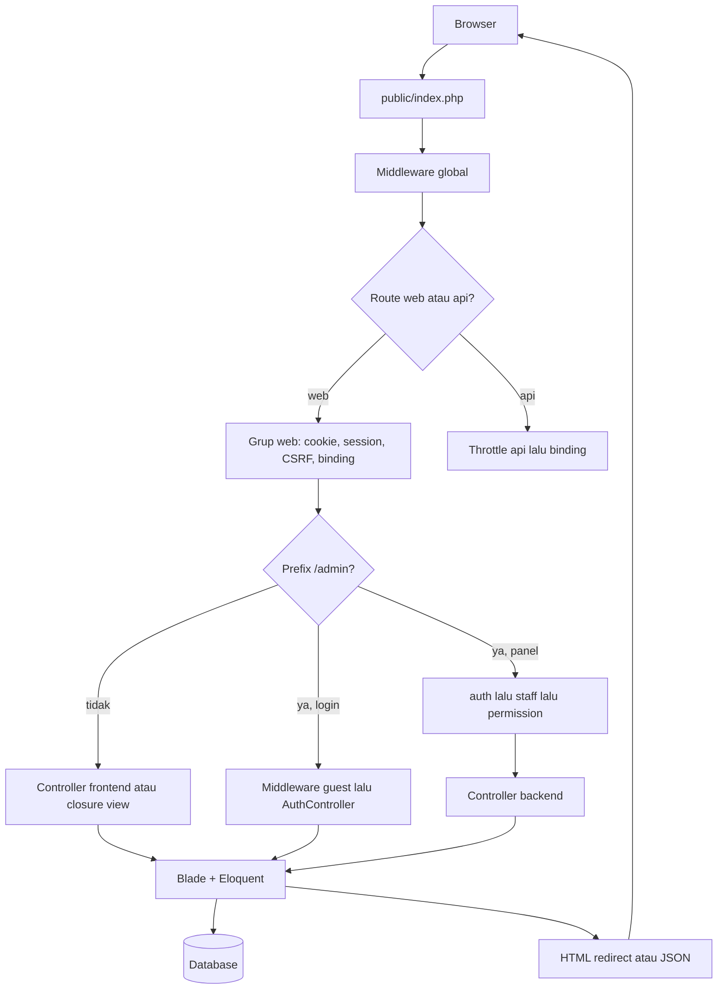

# 2. Arsitektur Aplikasi

Aplikasi mengikuti pola **MVC Laravel**.

- **Model** di `app/Models` mewakili tabel dan aturan domain yang menempel pada data, misalnya konfirmasi pelunasan dan pengiriman ulasan.
- **View** di `resources/views` adalah template Blade. View admin tidak memuat query bisnis yang mengubah data. Beberapa form membaca daftar pilihan lewat model agar opsi tampil.
- **Controller** menerima request, memvalidasi input, memanggil model, lalu mengembalikan view atau redirect.

Tidak ada lapisan service, repository, atau policy terpisah. Otorisasi ada di middleware dan method `User::allows()`.

## Alur satu request

Semua request HTTP masuk lewat `public/index.php`. `RouteServiceProvider` memuat `routes/web.php` di dalam grup middleware `web`, dan `routes/api.php` di dalam grup `api`.

Middleware global yang selalu jalan: `TrustProxies`, `HandleCors`, `PreventRequestsDuringMaintenance`, `ValidatePostSize`, `TrimStrings`, dan `ConvertEmptyStringsToNull`.

Grup `web` menambah enkripsi cookie, session, pembagian error validasi ke view, verifikasi CSRF, dan route-model binding.

## Hubungan Controller, Model, View, dan database

Contoh halaman kamar:

1. Request `GET /admin/room-management` masuk ke `RoomManagementController@index` setelah lolos `auth`, `staff`, dan salah satu permission lihat.
2. Controller memilih tab yang diizinkan, lalu mengambil `RoomCategory`, `RoomType`, `Room`, atau `RoomFacility`.
3. Method mengembalikan `view('backend.room-management.index', ...)`.
4. Blade menampilkan tabel dan form. Tombol yang mengubah data hanya muncul lewat `@allows` bila permission aksi itu ada.
5. `POST` atau `PUT` kembali ke controller, divalidasi, lalu ditulis lewat Eloquent. Redirect membawa flash `success` atau `error`.

`$site` disuntikkan ke setiap view `backend.*` dan `frontend.*` dari `Setting::current()`. Bila belum ada baris settings, composer mengirim instance `Setting` kosong.

## Middleware aplikasi

| Alias | Kelas | Efek |
| --- | --- | --- |
| `guest` | `RedirectIfAuthenticated` | Sesi yang sudah ada tidak melihat form login. Staf ke `backend.dashboard`, selain itu ke `home` |
| `auth` | `Authenticate` | Belum login: path `admin` dan `admin/*` ke `backend.login`, path lain ke `customer.login`. Request JSON tidak diarahkan |
| `staff` | `EnsureStaff` | User harus aktif dan `isStaff()`. Gagal diarahkan ke `home` dengan error sesi |
| `permission` | `EnsurePermission` | Argumen adalah satu atau lebih slug. `User::allows()` memakai logika **salah satu cukup**. Gagal menghasilkan HTTP 403 |

`isStaff()` benar bila user punya salah satu slug `super_admin`, `admin`, `receptionist`, `finance`, atau `housekeeping`.

Route panel, kecuali notifikasi, memasang `permission` per aksi. Halaman indeks yang menggabungkan beberapa tab memakai beberapa slug. Masuk ke halaman cukup dengan satu slug. Data di dalam tab tetap disaring controller lewat `allowedTab()` dan `emptyPage()` pada modul yang tab-nya bisa terpisah: kamar, booking, pembayaran, staf, laporan, serta ulasan dan pesan.

`GET /admin/notifications-settings` dan aksi bacanya **tidak** memakai middleware `permission`. Setiap staf yang sudah lolos `auth` dan `staff` dapat membuka halaman itu. Sidebar tetap menyembunyikan menu bila user tidak punya `notifications.view`.

## Autentikasi

Guard default adalah `web`, driver `session`, provider Eloquent `App\Models\User`. Tidak ada guard terpisah untuk customer dan staf.

### Login staf

`GET /admin/login` menampilkan `backend.auth.login`. `POST /admin/login` menerima `email`, `password`, dan `remember` opsional.

`Auth::attempt()` mencocokkan password. Bila gagal, kembali dengan error pada field email. Bila user nonaktif atau bukan staf, sesi langsung di-logout dan request dikembalikan dengan error. Bila lolos, session id di-regenerate, lalu user diarahkan ke `intended` URL atau `staffHome()`.

`staffHome()` memilih route pertama yang permission-nya dimiliki, berurutan: dashboard, booking, pembayaran, housekeeping, kamar, laporan, staf. Bila tidak ada, tujuan adalah halaman notifikasi.

### Login dan register customer

`POST /login` menolak user staf dan user nonaktif, lalu mengarahkan ke `home` lewat `intended`. Target `intended` yang mengarah ke `/admin` tidak dipakai. `POST /register` membuat user, menempelkan role `customer` yang aktif, membuat baris `customer_profiles` kosong, lalu login dan mengarah ke `home`.

Email customer diubah menjadi huruf kecil sebelum validasi. Password minimal 8 karakter dan wajib konfirmasi.

`POST /logout` customer dan `POST /admin/logout` staf sama-sama memanggil `Auth::logout()`, meng-invalidasi session, meregenerasi token CSRF, lalu mengarahkan customer ke `home` dan staf ke `backend.login`.

### Sanctum

Paket Sanctum terpasang dan migrasi `personal_access_tokens` ada. Satu-satunya route API adalah `GET /api/user` dengan `auth:sanctum`. Fitur hotel tidak menerbitkan atau memakai token itu.

## Otorisasi

Tidak ada policy. Keputusan akses ada di tiga tempat:

1. Middleware `staff` untuk memisahkan customer dari panel.
2. Middleware `permission` untuk setiap route ubah data.
3. `User::allows()` dan `@allows` untuk menyembunyikan menu, tab, dan tombol.

`allows()` mengembalikan benar untuk seluruh slug bila user punya role `super_admin`, tanpa membaca tabel permission. Role lain memakai slug yang menempel pada role-nya lewat `role_permissions`. Hasil slug di-cache pada instance user selama request.

Parameter route `{customer}` hanya menemukan user yang punya role `customer`. Mengirim id staf ke route customer menghasilkan 404.

Mengubah user lewat `StaffAccessController` menolak dua kondisi:

- user yang sedang login menonaktifkan dirinya atau melepas seluruh role stafnya;
- user tersebut adalah Super Admin aktif terakhir, lalu dinonaktifkan atau role `super_admin`-nya dilepas.

Role `super_admin` tidak dapat dihapus.
