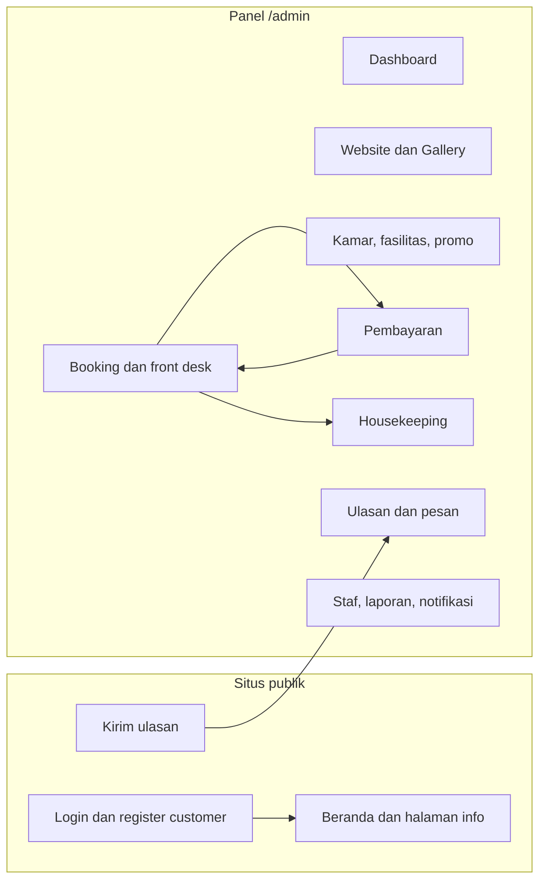
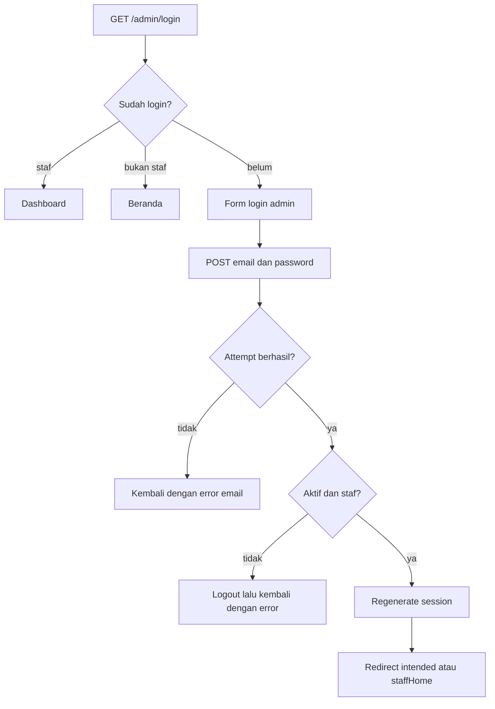
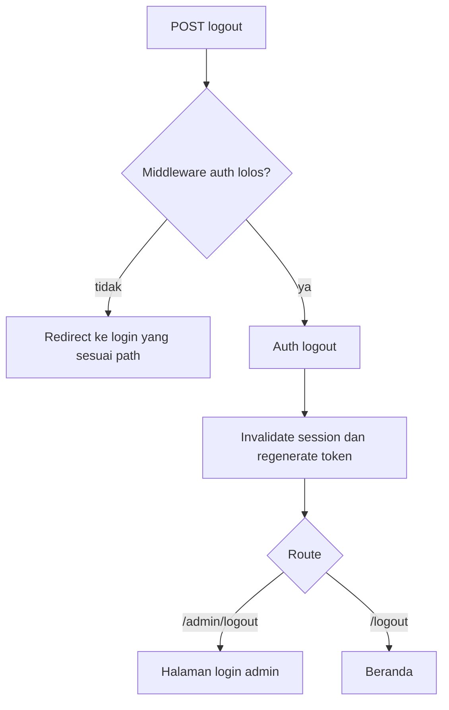
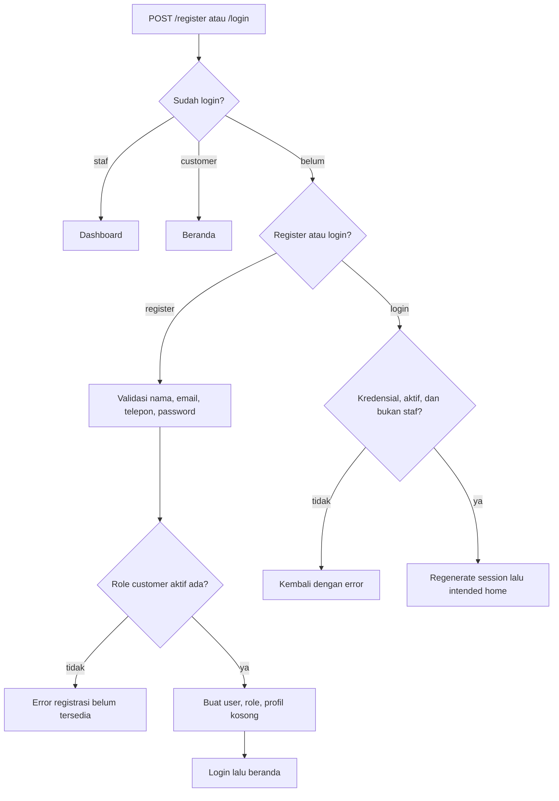
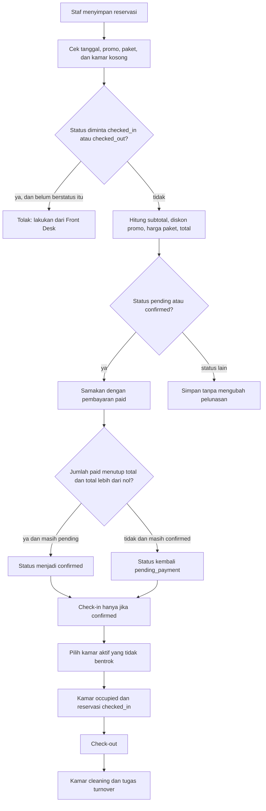
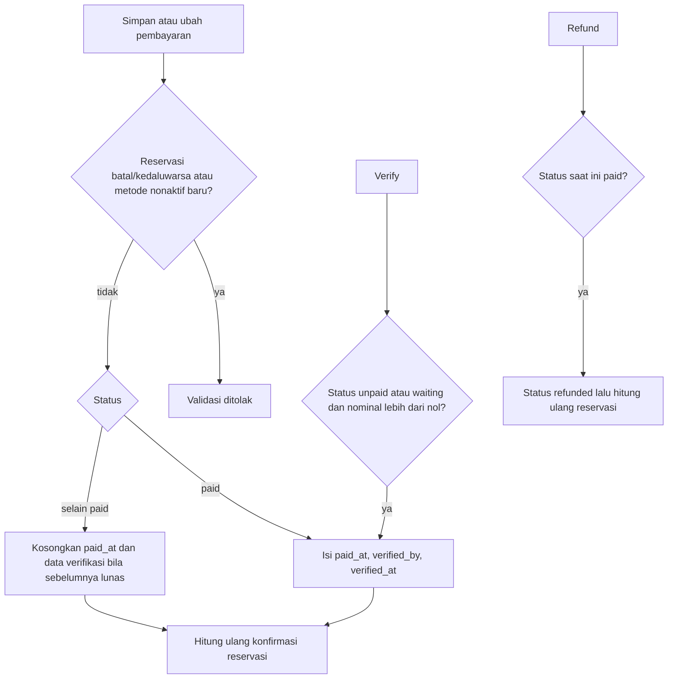
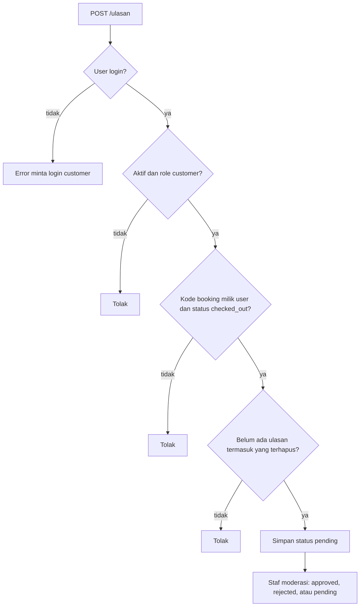

# 3. Alur Sistem

Diagram berikut mengikuti controller dan route yang aktif. Kotak keputusan memakai kondisi yang benar-benar diperiksa kode.

## Peta modul

Halaman publik `/`, `/kamar`, `/fasilitas`, `/reservasi`, `/tentang`, dan `GET /ulasan` langsung mengembalikan Blade. Mereka tidak membuat reservasi atau pembayaran.

## Login staf

## Logout staf dan customer

## Login dan register customer

## Reservasi, pelunasan, dan kamar

Aturan yang mengikat alur itu:

- Satu baris detail reservasi hanya untuk satu kamar (`quantity` maksimal 1).
- Kamar `maintenance` dan `out_of_order` tidak dialokasikan.
- Bentrok dihitung dari reservasi yang bukan `cancelled` atau `expired` dan tanggalnya beririsan.
- Check-in menolak status selain `confirmed`.
- Mengubah total reservasi `pending_payment` atau `confirmed` menjalankan `syncPaymentConfirmation()`.
- Meninggalkan `checked_in` menuju status lain melepas kamar yang masih `occupied`, selama tidak ada tamu `checked_in` lain di kamar itu.
- Reservasi `checked_out` tidak dapat diubah statusnya. Reservasi `checked_in` atau `checked_out` tidak dapat dihapus.

## Pembayaran tercatat

Tidak ada panggilan ke penyedia pembayaran. Staf mencatat transaksi.

Konfirmasi reservasi hanya mengubah `pending_payment` dan `confirmed`. Status `checked_in`, `checked_out`, `cancelled`, dan `expired` tidak diubah oleh pembayaran.

Pembayaran `paid` tidak dapat dihapus. Metode yang masih punya transaksi, termasuk yang sudah di-soft-delete, tidak dapat dihapus.

## Housekeeping

Check-out membuat tugas `turnover` berprioritas tinggi bila belum ada tugas sejenis yang `pending` atau `in_progress` untuk kamar dan reservasi yang sama.

Saat tugas diubah menjadi `verified`, kamar menjadi `available` hanya jika:

- tidak ada reservasi `checked_in` pada kamar itu, dan
- jenis tugas adalah `cleaning`, `inspection`, atau `turnover`.

Tugas `maintenance` yang diverifikasi tidak mengubah status kamar.

## Ulasan

Halaman `GET /ulasan` adalah Blade publik. Kode moderasi ada di panel. Daftar ulasan `approved` belum dirakit ke halaman publik oleh controller.

## Pesan kontak, konten, dan laporan

Tidak ada route publik yang membuat `contact_messages`. Panel hanya membaca, mengubah status (`new`, `read`, `followed_up`), dan menghapus pesan yang sudah ada. Membuka detail pesan `new` mengubahnya menjadi `read`.

Laporan membaca reservasi, pembayaran `paid`, kamar, dan `activity_logs`. Tab yang tidak diizinkan tidak diisi datanya. Penulisan `activity_logs` dari aksi admin tidak dipasang di controller menu yang aktif, sehingga isi log bergantung pada data yang sudah tersimpan.

Notifikasi memakai tabel notifikasi Laravel milik user yang login. Staf menandai satu atau semua notifikasinya sebagai terbaca, dan dapat mengganti nama, telepon, serta password sendiri.
